


 


 

<a href="https://github.com/FlaviusMarian27/Cisco-Enterprise-Network-Simulation"></a>
<a href="https://github.com/FlaviusMarian27/ExplodingKittens"></a>
<a href="https://github.com/FlaviusMarian27/System-Monitor"></a>
<a href="https://github.com/FlaviusMarian27/OperatingSystems"></a>
<a href="https://github.com/FlaviusMarian27/Clarity-Gym"></a>
<a href="https://github.com/FlaviusMarian27/GymManagerWeb"></a>
<a href="https://github.com/FlaviusMarian27/Microsistem-cu-microprocesor-8086"></a>
<a href="https://github.com/FlaviusMarian27/SystemC-ALU-Modules"></a>
<a href="https://github.com/FlaviusMarian27/MP3-MP4-Windows"></a>
<a href="https://github.com/FlaviusMarian27/MP3_converter"></a>
<a href="https://github.com/FlaviusMarian27/TicTacToe"></a>
<a href="https://github.com/FlaviusMarian27/Flavius-Project"></a>

 

 

  

  

<picture>
  <source media="(prefers-color-scheme: dark)" srcset="https://raw.githubusercontent.com/FlaviusMarian27/FlaviusMarian27/output/github-snake-dark.svg" />
  
</picture>

 


 

